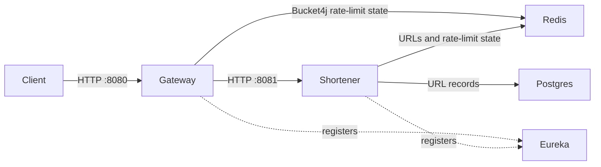

# URL Shortener

A Java 21 URL shortener built as three independent Spring Boot applications. The
gateway is the public HTTP entry point, the shortener creates and resolves links,
and Eureka provides service discovery.

## Architecture



| Component | Port | Responsibility |
| --- | ---: | --- |
| Gateway (`gateway/`) | 8080 | Routes create and redirect requests, resolves client IPs, and applies coarse rate limits. |
| URL shortener (`shortner/`) | 8081 | Validates URLs, generates short codes, stores links, resolves redirects, and applies service-side limits. |
| Eureka server (`server/`) | 8761 | Service registry for the gateway and shortener. It is not in the request path; the gateway currently uses a configured upstream host and port. |
| PostgreSQL | 5433 on the host | Durable URL records. |
| Redis | 6380 on the host | Gateway rate-limit state, shortener rate-limit state, and the redirect cache. |

The three applications have separate Gradle builds and wrappers; run Gradle from
the corresponding module directory. PostgreSQL and Redis are defined in
`shortner/docker-compose.yml`.

## Run locally

Prerequisites: Java 21 and Docker with Docker Compose. Run each service command
from the repository root in its own terminal.

Start the local database and cache:

```sh
cd shortner
docker compose up -d
```

In separate terminals, start the services in this order.

Eureka:

```sh
cd server
./gradlew bootRun
```

Create the local env file once from the gateway or shortener module:

```sh
cd gateway
./gradlew copyEnvDev
```

Edit `.env.dev` if your local ports or credentials differ from the Compose
defaults. The Gradle dev tasks load it and activate Spring's `local` profile.
Env files accept blank lines, `#` comments, and literal `KEY=value` entries;
quotes and shell variable expansion are not interpreted.

Shortener:

```sh
cd shortner
./gradlew bootRunDev
```

Gateway:

```sh
cd gateway
./gradlew bootRunDev
```

For a production-like local run, create `.env.prod` manually by copying
`.env.example`, replace the local database and Redis values with deployment
credentials, then run `./gradlew bootRunProd` from the gateway or shortener
module. This task activates the `prod` profile. Do not commit `.env.dev` or
`.env.prod`; deploy production credentials through the platform's secret store.

The API is available through the gateway at `http://localhost:8080`. The
shortener's Swagger UI and OpenAPI document are available directly at
`http://localhost:8081/swagger-ui.html` and `http://localhost:8081/v3/api-docs`.
The Eureka dashboard is at `http://localhost:8761`.

### Snowflake identity

The shortener encodes a Snowflake ID as the URL's Base62 code. Each process must
have a stable hostname and an explicitly assigned datacenter ID and machine ID.
Datacenter and machine IDs each use 5 bits, so valid values are 0–31. Assign a
different machine ID to every live hostname in a datacenter and keep the
assignment stable while that instance is running. The configured hostname must
appear in the machine-ID list; invalid, missing, or duplicate assignments stop
startup.

`SNOWFLAKE_MACHINE_IDS` is a comma-separated `hostname=id` list. The local
example above configures one host. For a multi-instance deployment in one
datacenter, a mapping might look like `shortener-0=0,shortener-1=1`; configure
each process with its own stable hostname and the same datacenter ID. The
application does not allocate slots dynamically, so deployment configuration
must prevent two live instances from claiming the same slot.

## HTTP API

Requests should go through the gateway on port 8080.

### Create a short URL

`POST /generate` accepts a JSON body with a nonblank URL up to 2048 characters.
The value must be a URL.

```sh
curl -i http://localhost:8080/generate \
  -H 'Content-Type: application/json' \
  -d '{"longUrl":"https://example.com/a/page"}'
```

Successful creation returns `201 Created` with the short URL in the response
body. The generated URL points to the gateway, using `APP_BASE_URL` (default
`http://localhost:8080`). Links expire after three hours.

### Follow a short URL

`GET /{shortCode}` returns `302 Found` with the original URL in the `Location`
header. Invalid, missing, and expired codes return `404 Not Found`.

```sh
curl -i http://localhost:8080/SHORT_CODE
```

Use `curl -i` without `-L` to inspect the redirect instead of following it.
Swagger UI's “Try it out” follows redirects in the browser; cross-origin
restrictions at an external destination can make that view fail even when the
redirect response is valid.

## Storage and caching

- PostgreSQL stores the Snowflake ID, original URL, creation time, and expiry
  time. Expired rows are treated as unavailable but are not automatically
  deleted by the current application.
- Redirect lookups use Redis cache-aside. Cache entries live for at most 30
  minutes and never beyond the link's expiry. Redis lookup failures fall back to
  PostgreSQL; cache write failures do not prevent a redirect.
- The local Compose Redis is limited to 256 MB and uses `allkeys-lfu` eviction.
- Hibernate uses `ddl-auto=update` for local development. No production schema
  migration workflow is included.

## Rate limiting and client identity

There are two independent rate-limit layers:

1. **Gateway:** Bucket4j stores coarse per-client buckets in Redis. The current
   capacities are 20 create requests per minute and 1200 redirect requests per
   minute. Limiter failures fail open at the gateway so a Redis issue does not
   make the gateway unavailable; the shortener has its own limits as a
   backstop.
2. **Shortener:** `rate_limit.lua` atomically checks and updates Redis token
   buckets across service instances. Creation uses a burst capacity of 20,
   refills at 10 requests per minute, and has a daily capacity of 200. Redirect
   misses use a burst capacity of 30 and refill at 20 per minute; only misses
   that return 404 are charged. The script runs in Redis so concurrent requests
   cannot both consume the same last token, and it uses Redis's clock for
   consistent refill timing.

If Redis is unavailable, the shortener falls back to in-memory per-instance
buckets, scaled by `app.rate-limit.instances` (default `1`). This fallback is
best-effort across a cluster, not a globally shared quota. At the gateway,
recognized limiter failures fail open only before the upstream handler has run;
upstream failures are propagated without retrying the request.

Both layers key IPv6 clients by their `/64` prefix, while IPv4 clients are keyed
by address. For IPv6, the current implementation uses the prefix as the key; it
does not keep separate per-address and per-prefix buckets. This helps prevent
bypass by rotating addresses within an IPv6 prefix, but clients sharing a
prefix also share a bucket. IPv4 clients behind the same NAT also share a
public address bucket. IP-based limits are therefore approximate for
households, offices, schools, and mobile networks. The current service has no
account or API-key identity for per-user quotas.

The gateway ignores `X-Forwarded-For` by default. Enable
`app.rate-limit.trust-forwarded-for` only when a trusted proxy in front of the
gateway overwrites that header. The gateway stamps `X-Client-Key` for the
shortener; configure `app.rate-limit.trusted-proxies` in the shortener with the
actual gateway peer addresses in a deployed network. Its local defaults trust
loopback addresses only.

## Configuration

The tracked `.env.example` documents the available environment variables.
Gradle's `copyEnvDev` and `bootRunDev` tasks create and load `.env.dev` for local
runs; `bootRunProd` loads a manually created `.env.prod`. Deployments should set
the same variables through their secret manager or orchestrator.

| Variable / property | Module | Default or requirement | Purpose |
| --- | --- | --- | --- |
| `APP_BASE_URL` | `shortner` | `http://localhost:8080` | Public base URL used in generated links. |
| `DB_HOST` | `shortner` | `localhost` | PostgreSQL host. |
| `DB_PORT` | `shortner` | `5433` | PostgreSQL host port. |
| `DB_NAME` | `shortner` | `shortner` | PostgreSQL database name. |
| `DB_USERNAME` | `shortner` | Required | PostgreSQL user; supply through deployment secrets. |
| `DB_PASSWORD` | `shortner` | Required | PostgreSQL password; supply through deployment secrets. |
| `REDIS_HOST` | `shortner` | `localhost` | Redis host for shortener cache and limiter. |
| `REDIS_PORT` | `shortner` | `6380` | Redis port for shortener cache and limiter. |
| `REDIS_PASSWORD` | `shortner` | Required (empty for local Compose) | Redis password; supply through deployment secrets. |
| `GATEWAY_REDIS_URI` | `gateway` | Required | Full Redis URI for gateway limits; include credentials and use `rediss://` when TLS is required. |
| `SPRING_PROFILES_ACTIVE` | `shortner`, `gateway` | `local` for local runs; omit `local` in production | Allows an empty Redis password only for local Compose use. |
| `MANAGEMENT_PORT` | `shortner` | `8082` | Separate Actuator listener port. |
| `MANAGEMENT_BIND_ADDRESS` | `shortner` | `127.0.0.1` | Management listener address; use only a private interface address for remote monitoring. |
| `SHORTNER_HOST` | `gateway` | `localhost` | Shortener upstream host. |
| `SHORTNER_PORT` | `gateway` | `8081` | Shortener upstream port. |
| `SNOWFLAKE_HOSTNAME` | `shortner` | `localhost` locally; set per instance | Stable hostname looked up in the machine-ID allocation. |
| `SNOWFLAKE_DATACENTER_ID` | `shortner` | Required, 0–31 | Snowflake datacenter field. |
| `SNOWFLAKE_MACHINE_IDS` | `shortner` | Required | Comma-separated `hostname=id` allocation for the datacenter. |

The shortener's local PostgreSQL user and password are `s_user` and `s_password`,
matching the Compose container. They are development credentials, not production
secrets. Production must supply `DB_USERNAME`, `DB_PASSWORD`, `REDIS_PASSWORD`,
and `GATEWAY_REDIS_URI` from its secret store. Never commit production values or
put them in command lines captured by deployment logs. Other settings, including
service ports, Eureka URL, rate limits, trusted proxy addresses, and forwarded
header behavior, are in each module's `src/main/resources/application.properties`.
Outside the `local` profile, the shortener rejects an empty Redis password and
the gateway requires credentials in `GATEWAY_REDIS_URI`; percent-encode reserved
characters in URI credentials.

## Tests

Each module has its own test task. Run from its directory:

```sh
(cd server && ./gradlew test)
(cd gateway && ./gradlew test)
(cd shortner && ./gradlew test)
```

The shortener application-context test requires PostgreSQL. Its Redis limiter
integration tests use a real Redis at `localhost:6380` and skip when it is
unavailable. Start the Compose dependencies before running the complete
shortener test suite:

```sh
cd shortner
docker compose up -d
./gradlew test
```

## Deployment notes

This repository is a development project, not a production-ready deployment
bundle. Actuator exposes only `health`, `info`, and `metrics` on the shortener's
separate management port (8082), bound to loopback by default. For remote
monitoring, set `MANAGEMENT_BIND_ADDRESS` to a private interface address and
allow access only from the monitoring network in firewall/security-group rules.
Do not bind the management listener to a public interface. Production credentials
must come from a secret store; do not reuse the local Compose credentials. Review
trusted-proxy and forwarded-header settings before deployment.

For shortener-specific local usage and redirect notes, see
[`shortner/README.md`](shortner/README.md).
